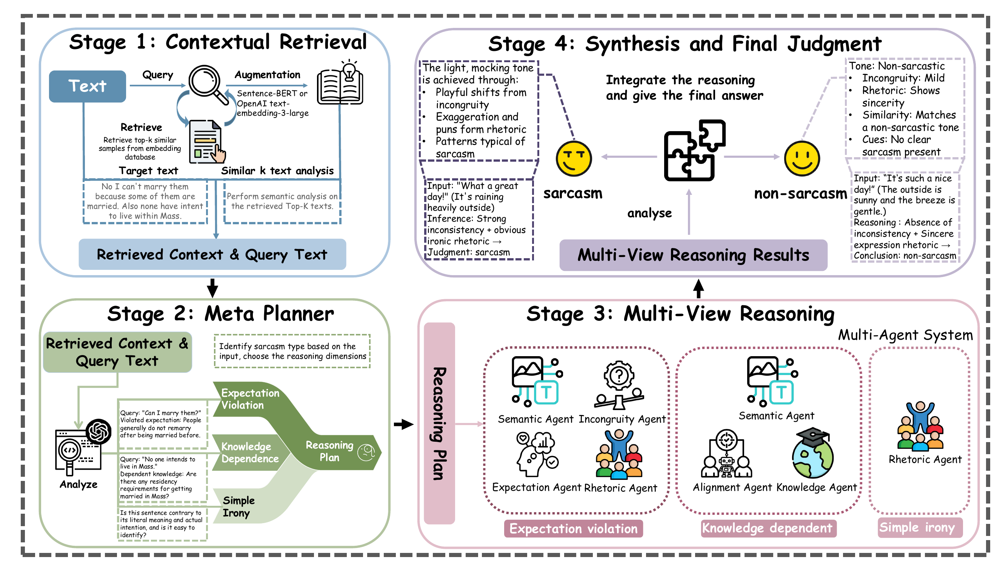

<div align="center">

<h1>RAM-SD</h1>
<h3>Retrieval-Augmented Multi-agent Framework<br>for Sarcasm Detection</h3>

<p><strong>ACL 2026 &middot; Long Paper</strong></p>

<p>
  Ziyang Zhou<sup>*</sup>, Ziqi Liu<sup>*</sup>, Yan Wang, Yiming Lin, Yangbin Chen<br>
  Xi'an Jiaotong-Liverpool University<br>
  <sub><sup>*</sup> Equal contribution</sub>
</p>

<p>
  <a href="https://aclanthology.org/2026.acl-long.64/"></a>
  <a href="https://arxiv.org/abs/2601.17002"></a>
  <a href=".python-version"></a>
  <a href="LICENSE"></a>
  <a href="https://github.com/Azhou0/RAM-SD/actions/workflows/tests.yml"></a>
</p>

<p>
  <a href="https://aclanthology.org/2026.acl-long.64/"><strong>ACL Anthology</strong></a> &nbsp;&middot;&nbsp;
  <a href="https://aclanthology.org/2026.acl-long.64.pdf"><strong>Paper PDF</strong></a> &nbsp;&middot;&nbsp;
  <a href="https://arxiv.org/abs/2601.17002"><strong>arXiv</strong></a> &nbsp;&middot;&nbsp;
  <a href="https://doi.org/10.18653/v1/2026.acl-long.64"><strong>DOI</strong></a> &nbsp;&middot;&nbsp;
  <a href="CITATION.bib"><strong>BibTeX</strong></a>
</p>

<p>
  <a href="#installation">Quick Start</a> &nbsp;&middot;&nbsp;
  <a href="docs/DATASETS.md">Datasets</a> &nbsp;&middot;&nbsp;
  <a href="#run-an-experiment">Experiments</a> &nbsp;&middot;&nbsp;
  <a href="#citation">Citation</a>
</p>

</div>

## Overview

RAM-SD combines balanced example retrieval, rationale generation, adaptive meta-planning, and specialized agents for sarcasm detection. A meta-planner selects a reasoning plan for each input, invokes complementary agents, and synthesizes their findings into a judgment with an explanation.

<p align="center">
  <a href="assets/ram_sd_overview.png">
    
  </a>
</p>
<p align="center">
  <em>Figure 1. The four-stage RAM-SD framework, reproduced from the ACL 2026 paper. Click the figure to view the full-resolution image.</em>
</p>

- **Balanced contextual retrieval:** ground each query in sarcastic and non-sarcastic training examples with explanatory rationales.
- **Adaptive reasoning:** select expectation-violation, knowledge-dependent, or simple-irony plans for different inputs.
- **Interpretable reasoning:** combine specialist evidence into a final judgment with a natural-language explanation.

## Method

1. **Contextual retrieval:** retrieve the top-k sarcastic and top-k non-sarcastic training examples from separate FAISS cosine-similarity indexes; generate a rationale for each example and compare their patterns with the query.
2. **Meta-planning:** use the retrieved evidence to select an expectation-violation, knowledge-dependent, or simple-irony plan and infer contextual guidance.
3. **Multi-view reasoning:** execute the selected Semantic, Expectation, Knowledge, Alignment, Incongruity, and Rhetoric roles as applicable.
4. **Synthesis:** integrate the evidence into a final judgment and explanation.

Retrieval uses only the same dataset's training split. MUSTARD disables retrieval and supplies dialogue context directly to downstream stages.

## Installation

Use Python 3.12 and [uv](https://docs.astral.sh/uv/):

```bash
git clone https://github.com/Azhou0/RAM-SD.git
cd RAM-SD
uv sync --frozen --no-editable
```

Dependencies are pinned in `uv.lock`. For pip installation, install `requirements.lock.txt`, then run `python -m pip install --no-deps .`.

## Datasets

Download the benchmarks from their [official sources](docs/DATASETS.md) and organize the CSV files as follows:

```text
data/
  iacv1/train.csv     iacv1/test.csv
  iacv2/train.csv     iacv2/test.csv
  semeval/train.csv   semeval/test.csv
  mustard/test.csv    # train.csv is optional; no retrieval
```

Each CSV requires `Text,Label`, where `0` denotes non-sarcastic and `1` denotes sarcastic. MUSTARD also requires a nonempty `Context` column. An optional `row_id` column provides unique sample IDs. Format-conversion instructions are available in the [dataset guide](docs/DATASETS.md).

Check the input files with:

```bash
uv run --frozen --no-editable ram-sd audit-data \
  --dataset iacv1 --data-dir data
```

Add `--strict-counts` to check dataset sizes against Table 1.

## Experimental configuration

Create a local `.env` using [.env.example](.env.example) and set `OPENAI_API_KEY`.

| Parameter | Setting |
|---|---|
| Reasoning model | GPT-4o |
| Temperature | 0.1 |
| Top-p | 1.0 |
| Maximum output tokens | 512 |
| Generations per prompt | 1 |
| Frequency / presence penalties | 0 / 0 |
| Embedding model | text-embedding-3-large |
| Embedding dimensions | 3072 |
| Retrieved examples | 3 per label |
| Similarity search | FAISS, cosine similarity after L2 normalization |

The default configuration is [configs/appendix.json](configs/appendix.json). [configs/maintext.json](configs/maintext.json) provides the separate probability-based Judger described in Section 3.4.

## Run an experiment

Build a training-only retrieval index, then evaluate:

```bash
uv run --frozen --no-editable ram-sd build-index \
  --config configs/appendix.json --dataset iacv1 --data-dir data \
  --env-file .env --mode live

uv run --frozen --no-editable ram-sd run \
  --config configs/appendix.json --dataset iacv1 --data-dir data \
  --env-file .env --mode live --out outputs/appendix/iacv1
```

Replace `iacv1` with `iacv2` or `semeval` for the other retrieval-based benchmarks. For MUSTARD, skip index construction and run:

```bash
uv run --frozen --no-editable ram-sd run \
  --config configs/appendix.json --dataset mustard --data-dir data \
  --env-file .env --mode live --out outputs/appendix/mustard
```

Run all four datasets with:

```bash
bash scripts/run_main.sh /absolute/path/to/data appendix live outputs/main 0 .env
```

The final two arguments are the retrieval insertion-order seed and the env-file path. Use `--limit N` for a subset of test samples or `--resume` to continue an existing run.

## Outputs

Each output directory contains:

- `predictions.csv`: predictions, confidence, selected reasoning plans, and sample labels.
- `metrics.json`: Accuracy, Precision, Recall, F1, Macro-F1, and the confusion matrix.
- `traces/`: retrieved examples, agent analyses, and final explanations.

To replay saved model responses, use the same configuration with `--mode replay` and a new output directory.

## Evaluation

Use the same `--retrieval-order-seed` for index construction and evaluation. This controls per-label vector insertion order; MUSTARD does not use retrieval.

Aggregate compatible runs:

```bash
uv run --frozen --no-editable ram-sd summarize \
  outputs/run0/iacv1/metrics.json outputs/run1/iacv1/metrics.json \
  --output outputs/summary.json
```

The summary reports means and sample standard deviations (`ddof=1`). When all four datasets are supplied, it also reports their unweighted mean.

For a paired exact McNemar test against baseline predictions:

```bash
uv run --frozen --no-editable ram-sd compare \
  --predictions outputs/main/iacv1/predictions.csv \
  --baseline /path/to/baseline_predictions.csv \
  --output outputs/mcnemar.json
```

The baseline CSV must contain matching `row_id,label,prediction` records.

## Citation

If you use RAM-SD, please cite the ACL 2026 paper. [CITATION.bib](CITATION.bib) includes entries for both the [published version](https://aclanthology.org/2026.acl-long.64/) and the [arXiv preprint](https://arxiv.org/abs/2601.17002).

```bibtex
@inproceedings{zhou-etal-2026-ram,
  title = "{RAM}-{SD}: Retrieval-Augmented Multi-agent framework for Sarcasm Detection",
  author = "Zhou, Ziyang and Liu, Ziqi and Wang, Yan and Lin, Yiming and Chen, Yangbin",
  booktitle = "Proceedings of the 64th Annual Meeting of the Association for Computational Linguistics (Volume 1: Long Papers)",
  month = jul,
  year = "2026",
  address = "San Diego, California, United States",
  publisher = "Association for Computational Linguistics",
  pages = "1434--1448",
  doi = "10.18653/v1/2026.acl-long.64",
  url = "https://aclanthology.org/2026.acl-long.64/"
}
```

## License

The implementation is distributed under the [MIT License](LICENSE). The paper figure is reproduced with attribution under [CC BY 4.0](assets/README.md). Dataset licenses and provider terms apply separately.
